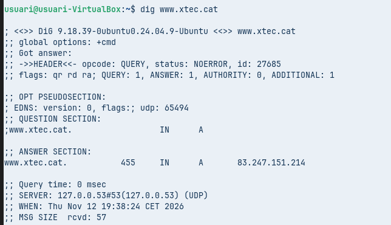
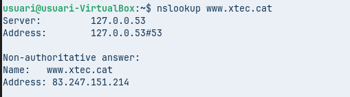
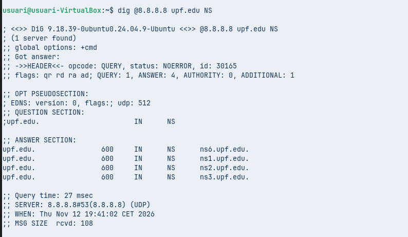
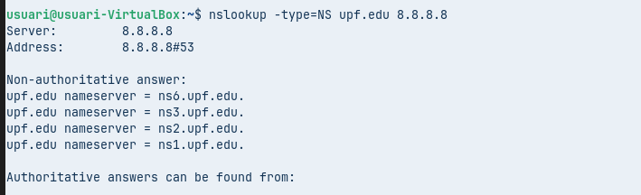
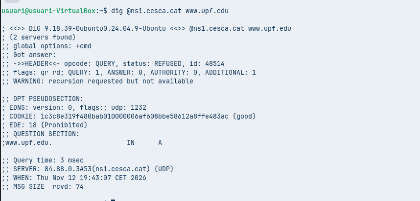
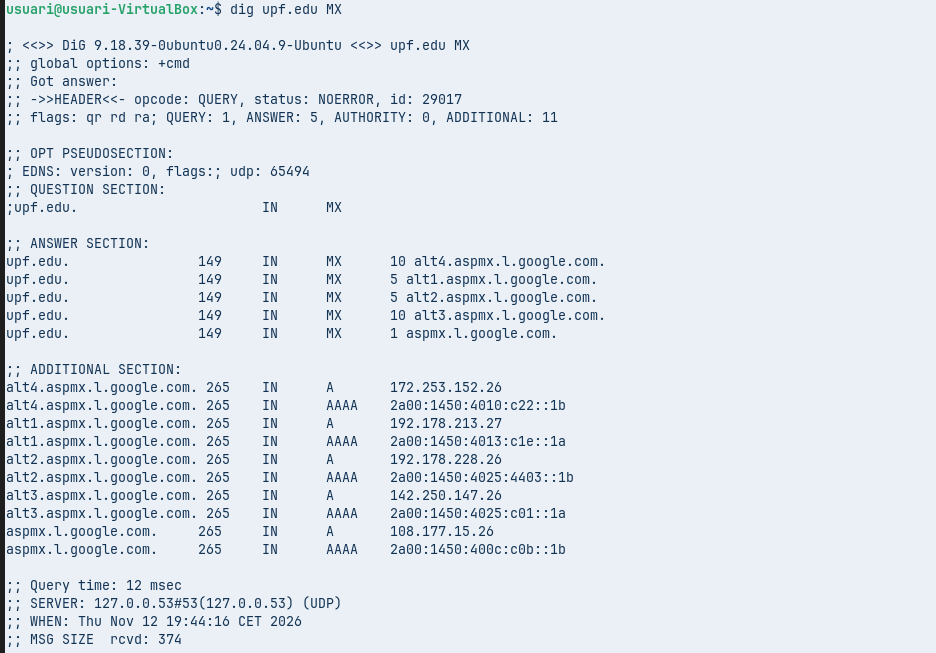
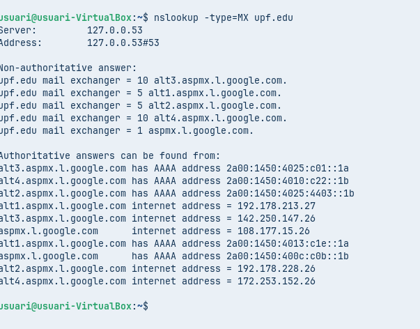
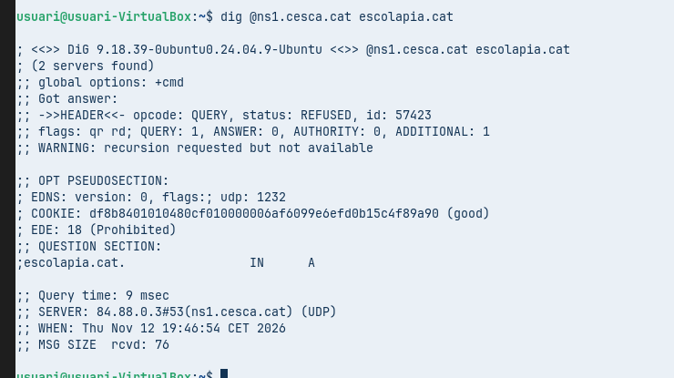
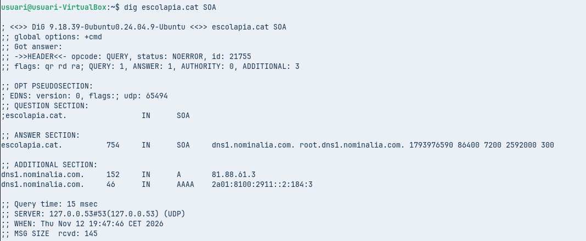
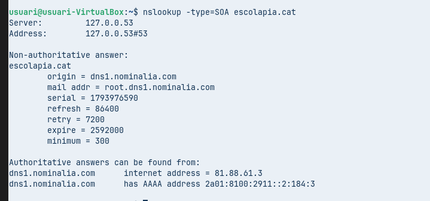

# Pràctica de consultes DNS

## 1. Consulta la IP de `www.xtec.cat` i comprova que la resposta és no-autoritativa

**Comanda a Linux (`dig`):**

```bash
dig www.xtec.cat
```




**Comanda alternativa (`nslookup`):**

```bash
nslookup www.xtec.cat
```




**Comprovació:** la resposta és no-autoritativa perquè el servidor DNS local que s'utilitza no conté la zona corresponent al domini sol·licitat i ha de fer ell la consulta a un altre servidor.

- Si s'utilitza `dig`, es comprova observant que a la secció de capçalera no apareix l'indicador `aa` (*authoritative answer*).
- Si s'utilitza `nslookup`, l'eina ho indica directament amb el text `Non-authoritative answer`.

---

## 2. Consulta usant el servidor de Google `8.8.8.8` per conèixer el NS de `upf.edu`

**Comanda a Linux amb `dig`:**

```bash
dig @8.8.8.8 upf.edu NS
```




**Comanda alternativa amb `nslookup`:**

```bash
nslookup -type=NS upf.edu 8.8.8.8
```




**Explicació:** mitjançant el paràmetre `@8.8.8.8` s'indica a `dig` quin servidor DNS específic ha de processar la petició per obtenir els servidors de noms (registres NS).

---

## 3. Consulta usant un dels servidors de noms de `upf.edu` per a `www.upf.edu` i comprova que és autoritativa

**Comanda a Linux amb `dig`:**

```bash
dig @ns1.cesca.cat www.upf.edu
```



**Comprovació:** quan la consulta es fa directament al servidor que conté la informació del domini, la resposta és autoritativa. En la sortida de `dig`, es confirma observant que a l'apartat de *flags* de la capçalera sí que apareix l'indicador `aa` (*authoritative answer*).

---

## 4. Consulta els dominis de correu de `upf.edu`

**Comanda a Linux amb `dig`:**

```bash
dig upf.edu MX
```



**Comanda alternativa amb `nslookup`:**

```bash
nslookup -type=MX upf.edu
```



**Explicació:** els registres MX (*Mail Exchange*) especifiquen quins són els servidors de correu associats al domini.

---

## 5. Comprova que usant el servidor de noms de la UPF no pots fer una consulta del domini `escolapia.cat`

**Comanda a Linux amb `dig`:**

```bash
dig @ns1.cesca.cat escolapia.cat
```



**Comprovació:** com que el servidor autoritatiu de la UPF només respon de les seves pròpies zones i no té la recursió activada per a dominis externs, la petició no es resoldrà i `dig` mostrarà l'avís:

```
WARNING: recursion requested but not available
```

---

## 6. Mostra el registre SOA del domini `escolapia.cat`

**Comanda a Linux amb `dig`:**

```bash
dig escolapia.cat SOA
```




**Comanda alternativa amb `nslookup`:**

```bash
nslookup -type=SOA escolapia.cat
```




**Explicació:** el registre SOA (*Start of Authority*) conté la informació administrativa de l'autoritat de la zona DNS.

---
